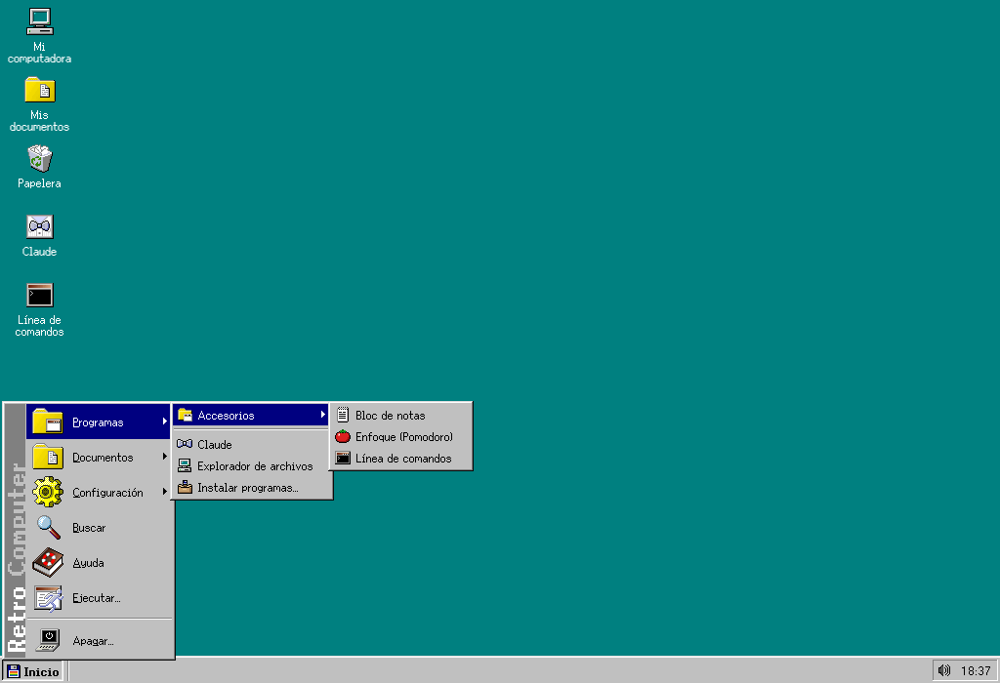
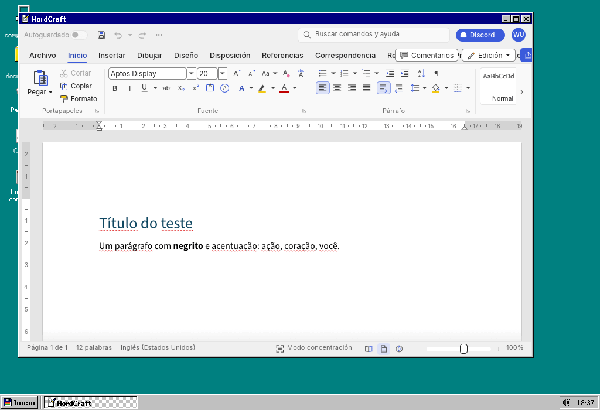
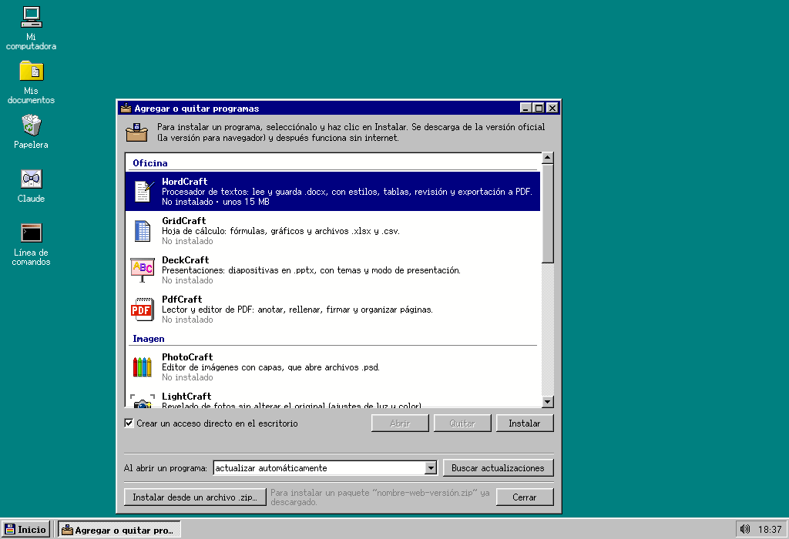
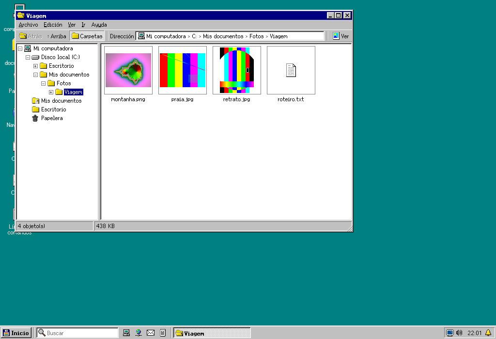
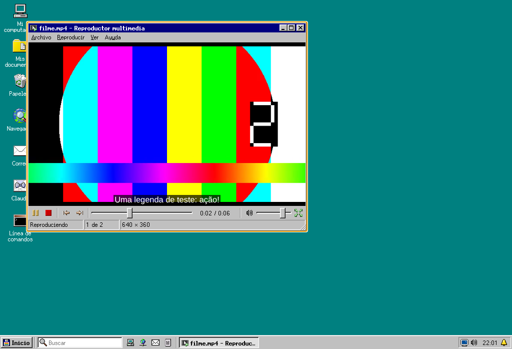
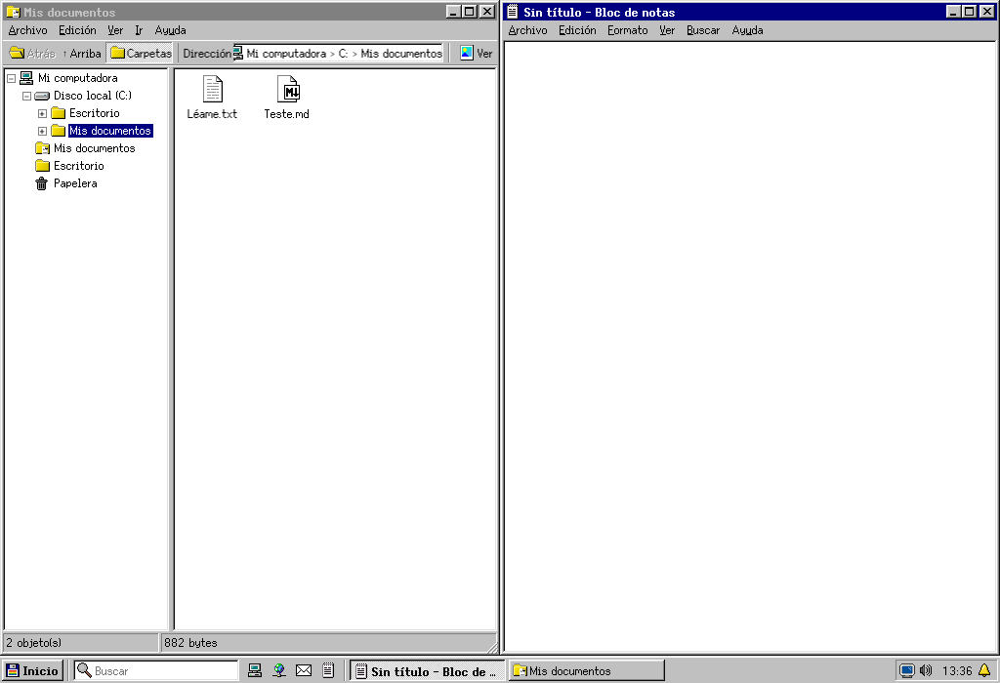
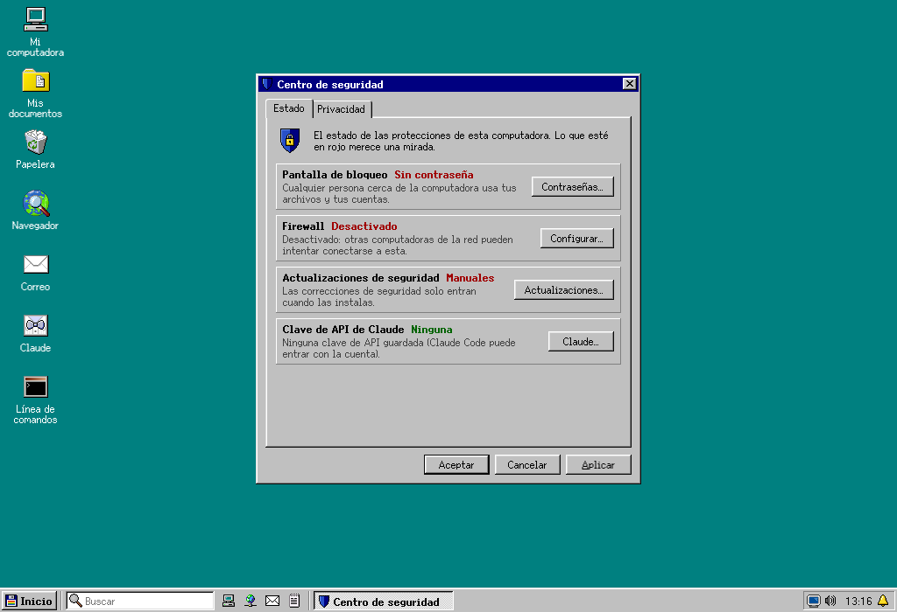
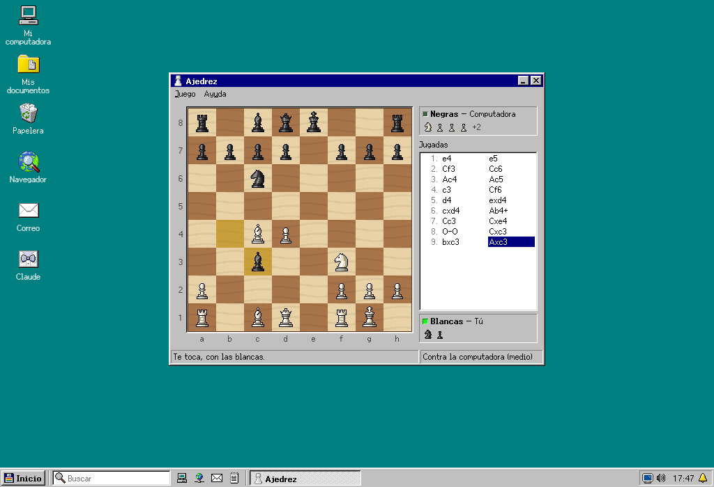
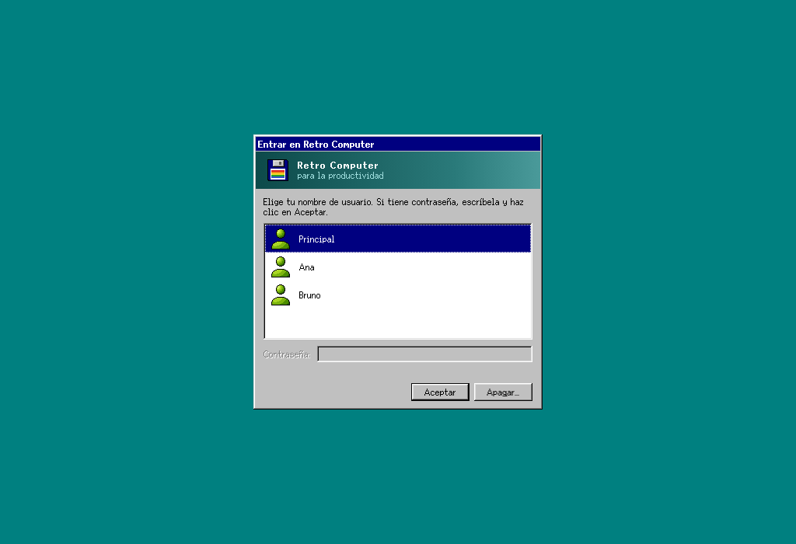

# Retro Computer

[English](README.md) · [Português](README.pt-BR.md) · **Español**

Una computadora retro para la productividad: el escritorio de una PC de los años 90, con tus programas de trabajo, tus archivos y Claude Code, sin las distracciones de la computadora de hoy. Funciona en Windows, macOS y Linux (incluida la Raspberry Pi), y en Linux puede ser el sistema completo de la computadora, convirtiendo una laptop vieja o una mini PC en una computadora retro dedicada. Código abierto (licencia MIT).

- **Versión:** 2.0.5 · [Descargar](https://github.com/EduChacon/Retro-Computer-for-Productivity/releases/latest)
- **Idiomas:** español, inglés y portugués (Panel de control › Idioma)



## Qué hace

- **Un escritorio de los años 90**: botón Inicio, barra de tareas, ventanas que se arrastran y cambian de tamaño, iconos, menús, la Papelera y el cuadro Apagar, con letras e iconos nítidos en cualquier monitor.
- **O un Mac de los años 90**: el tema Mac clásico, inspirado en Mac OS 9 (Panel de control › Apariencia › Tema), pone la barra de menús arriba de la pantalla, da a las ventanas el título con rayas y la casilla de contraer, trae la Tira de control con los programas anclados y tiene iconos propios, todos dibujados por el proyecto.
- **Ventanas que se acoplan y los atajos de siempre**: arrastra la ventana hasta un borde (la mitad de la pantalla) o hasta una esquina (un cuarto); Alt+Tab, Alt+F4 y la tecla del logotipo con una letra (E, R, D, V, L…) o con las flechas; Ctrl + la rueda del mouse para el zoom.
- **Una barra de tareas como la de hoy**: el cuadro de búsqueda y los programas anclados junto a Inicio; la bandeja con el Wi-Fi, el volumen, la batería y el brillo, el Bluetooth, las notificaciones y el calendario; y la pantalla de bloqueo con contraseña.
- **El disco C: es una carpeta de tu computadora** (`Documentos/Retro Computer`): lo que guardas también se ve fuera del programa. Para traer archivos, arrástralos a una ventana; para llevarlos, usa "Enviar a". Mi computadora › Computadora principal muestra el escritorio, los documentos y las descargas de la computadora principal, y Retro Computer puede entrar en "Enviar a" de Windows (en Mac, suelta los archivos en su icono del Dock): los archivos van y vuelven, siempre como copias. Eliges el programa predeterminado de cada tipo de archivo. El Explorador tiene pestañas, el panel de carpetas, la dirección en la que se puede hacer clic, las miniaturas, el Acceso rápido, el panel de vista previa de los documentos de Word, los PDF y las hojas de cálculo y la vista rápida con la barra espaciadora; el cuadro de búsqueda y Buscar también buscan dentro de los documentos (textos, Word, hojas de cálculo, presentaciones y PDF); las memorias USB y las tarjetas aparecen en Mi computadora, y los `.zip` se abren como carpetas.
- **Nada se pierde**: eliminar manda a la Papelera, y cada vez que guardas se conserva la versión anterior del archivo.
- **Programas de trabajo**: los [Craft](https://artcraft.run/) de código abierto (WordCraft para textos `.docx`, GridCraft para hojas de cálculo, DeckCraft para presentaciones, PdfCraft, PhotoCraft y otros), instalados desde su versión oficial para navegador y ejecutándose dentro de las ventanas. Sus cuadros Abrir y Guardar usan el disco C:. Los programas instalados en la computadora también se abren desde Inicio, y "Agregar o quitar programas" instala además los programas de la propia computadora, de fuentes oficiales: Flathub en Linux, winget en Windows y Homebrew en el Mac.
- **Siempre actualizado**: al abrir un programa, Retro Computer busca la versión nueva y la instala antes (o pregunta, o no busca, como prefieras). Retro Computer también se actualiza solo.
- **Claude Code** en la Línea de comandos, trabajando en tus archivos, con tu suscripción de Claude o con una clave de API guardada en el almacén de contraseñas del sistema. Con el botón derecho en un archivo › Pedir a Claude, lo revisa, lo resume o lo traduce; y, pidiéndoselo con palabras, ajusta el propio Retro Computer (el fondo, la barra de tareas, el menú Inicio, los programas): lo que borra va a la Papelera, y la contraseña y la clave quedan fuera de su alcance.
- **Internet**: Firefox como navegador predeterminado, con el aspecto de Retro Computer (o el Navegador integrado, en el que la cámara, el micrófono y las notificaciones piden tu permiso), y tu correo de la web en una ventana; cualquier sitio se puede instalar como programa.
- **Herramientas incluidas**: Visor de imágenes, Reproductor multimedia, Captura de pantalla, Monitor del sistema, Calculadora (también en el propio cuadro de búsqueda), Bloc de notas, el historial del portapapeles (logotipo + V), Enfoque (Pomodoro, cronómetro y temporizador), la luz nocturna, impresoras, Buscar, Ejecutar, Panel de control, protector de pantalla, Ayuda, el Diario de trabajo, el Mapa de caracteres, la copia de seguridad del disco C:, el antivirus a pedido, Discos (formatear memorias USB, grabar imágenes `.iso` en ellas y el espacio en disco, con la limpieza), el Lector de PDF (resaltar fragmentos y poner notas, con el original guardado como versión anterior), Guardar como PDF en el Bloc de notas, el Visor de imágenes y el Navegador, las Herramientas de PDF (combinar, separar, extraer páginas, girar y convertir imágenes), Escanear (los escáneres en Linux y Windows) y Copiar el texto (el OCR de las fotos y los PDF escaneados, sin internet), la Agenda (un `.ics` común del disco C:, con recordatorios, y los calendarios de internet, como Google Calendar y Outlook, solo para leer), la nube en Linux (Google Drive, OneDrive y Dropbox como unidades en Mi computadora), el corrector ortográfico (portugués, inglés y español, sin internet), las notas adhesivas en el escritorio, Recibir del celular (fotos y archivos por la red local, con el código QR), el panel de emojis (logotipo + .), los escritorios virtuales con la Vista de tareas (logotipo + Tab), las combinaciones de colores (también oscuras, que cambian solas con la puesta del sol), las Opciones de accesibilidad y cinco juegos (Solitario, Buscaminas, Breakout, Damas y Ajedrez, contra la computadora o contra alguien).
- **DOS, Mac y programas de Windows**: un emulador de DOS integrado (sin internet) para los programas y los juegos antiguos del disco C:, un emulador del Mac Plus para los juegos clásicos del Macintosh (con la ROM y los discos de tu Mac: nada de Apple viene incluido) y, en Linux, los programas de Windows con WINE.
- **Varios usuarios**: cada persona con su propio escritorio, su configuración, su contraseña y su disco C:, elegida al abrir Retro Computer; los programas son de todos.
- **Seguridad y privacidad en un solo lugar**: el Centro de seguridad muestra la contraseña de la pantalla de bloqueo, el firewall (en Linux), las actualizaciones de seguridad automáticas y cómo está guardada la clave de Claude; el Navegador solo abre conexiones seguras (HTTPS), salvo que elijas otra cosa, y puede borrar sus datos al cerrar.
- **Linux como sistema**: la sesión "Retro Computer" de la pantalla de inicio de sesión abre directo en él; Apagar apaga la computadora de verdad, los programas de Linux aparecen en la barra de tareas, las actualizaciones de seguridad se instalan desde el Panel de control, el sonido, la energía, la fecha y la hora, el mouse, la resolución y las varias pantallas se ajustan en el Panel de control, y las teclas del logotipo, de volumen, de brillo e Impr Pant funcionan.
- **En una memoria USB**: con una carpeta `Retro Computer (dados)` junto al programa, la configuración, los programas y el disco C: viajan con ella (el modo portátil).

| | |
|---|---|
|  |  |
|  |  |
|  |  |
|  |  |

## Instalar

Descarga el instalador de tu sistema en la [última versión](https://github.com/EduChacon/Retro-Computer-for-Productivity/releases/latest):

| Sistema | Archivo |
|---|---|
| Windows | `Retro-Computer-…-win-x64.exe` (instalador) o `…-win-x64.zip` |
| macOS 12 o más nuevo | `…-mac-arm64.dmg` (Apple Silicon) o `…-mac-x64.dmg` (Intel) |
| Linux (PC) | `…-linux-amd64.deb` o `…-linux-x86_64.AppImage` |
| Linux (Raspberry Pi, 64 bits) | `…-linux-arm64.deb` o `…-linux-arm64.AppImage` |

Los instaladores todavía no tienen firma digital, por eso el sistema pide una confirmación la primera vez:

- **macOS**: Ajustes del Sistema › Privacidad y seguridad › Abrir igualmente (hasta macOS 14, también clic derecho en la aplicación › Abrir › Abrir).
- **Windows**: en la pantalla de SmartScreen, "Más información" › "Ejecutar de todas formas".

La [guía de instalación](docs/instalacao.md) (en portugués) tiene los pasos para cada computadora: Windows, macOS, una Mac vieja (como la MacBook Air de 2014, con Linux Mint), una máquina virtual en UTM, una laptop vieja o mini PC y la Raspberry Pi.

### Como sistema de Linux (una laptop vieja, una Raspberry Pi o una mini PC)

Instala el paquete `.deb` (`sudo apt install ./Retro-Computer-1.0.0-linux-amd64.deb`, o el `arm64` en la Raspberry Pi) y elige la sesión **Retro Computer** en la pantalla de inicio de sesión: la computadora abre directo en Retro Computer, sin el escritorio de Linux debajo. Mira [la guía de uso (en portugués), sección 7](docs/uso.md#7-num-mini-computador-raspberry-pi-e-como-o-sistema-do-linux). En la Raspberry Pi 4 o 5 (4 GB o más) funciona todo; en la Raspberry Pi 3 (1 GB) funcionan el escritorio, el Bloc de notas, Enfoque y la Línea de comandos, pero los Craft (que necesitan WebGL2) van muy lentos y Claude Code pide 4 GB de memoria.

## Desarrollar

```
npm install      # instala las dependencias (y compila la terminal para Electron)
npm start        # abre Retro Computer
npm test         # las pruebas
```

El código y la guía para desarrolladores están en portugués: [AGENTS.md](AGENTS.md). Las traducciones están en [`src/sistema/idiomas/`](src/sistema/idiomas/), y `node ferramentas/textos.js` muestra las que faltan.

## Créditos

Iconos y fuentes del sistema de [SerenityOS](https://github.com/SerenityOS/serenity) (BSD-2-Clause), con dibujos propios del proyecto; terminal con xterm.js y node-pty; el DOS con [js-dos](https://js-dos.com/) (el emulador DOSBox, GPL-2.0, sin modificar); el Mac Plus con [PCE.js](https://github.com/jsdf/pce) (GPL-2.0, sin modificar); la vista previa de los documentos con mammoth y pdf.js; los `.zip` con yauzl y yazl; la actualización de la aplicación con electron-updater; aplicación hecha con Electron. Los programas de la computadora vienen de Flathub, winget y Homebrew. Los Craft son del ArtCraft Team y se descargan de sus versiones oficiales. Detalles en [ATRIBUICOES.md](ATRIBUICOES.md).

El aspecto rinde homenaje a las computadoras personales de los años 90; no se usa ningún icono, fuente, sonido ni imagen de Microsoft ni de Apple.
