# Retro Computer

**English** · [Português](README.pt-BR.md) · [Español](README.es.md)

A retro computer for productivity: the desktop of a 1990s PC, with your work programs, your files and Claude Code, without the distractions of today's computer. It runs on Windows, macOS and Linux (including the Raspberry Pi), and on Linux it can be the computer's whole system, turning an old laptop or a mini PC into a dedicated retro computer. Open source (MIT license).

- **Version:** 1.8.0 · [Download](https://github.com/EduChacon/Retro-Computer-for-Productivity/releases/latest)
- **Languages:** English, Portuguese and Spanish (Control Panel › Language)

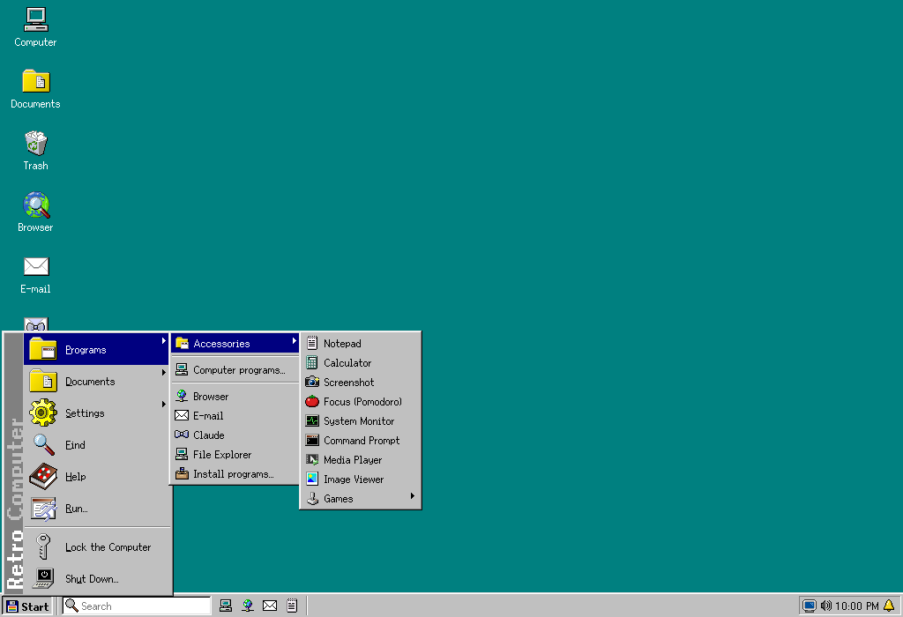

## What it does

- **A 1990s desktop**: Start button, taskbar, windows you can drag and resize, icons, menus, the Trash and the Shut Down dialog, with sharp letters and icons on any monitor.
- **Or a 1990s Mac**: the Classic Mac theme, inspired by Mac OS 9 (Control Panel › Appearance › Theme), puts the menu bar at the top of the screen, gives the windows the striped title and the collapse box, brings the Control Strip with the pinned programs and has its own icons, all drawn by the project.
- **Windows that snap, and the shortcuts you know**: drag a window to an edge for half of the screen or to a corner for a quarter; Alt+Tab, Alt+F4 and the logo key with a letter (E, R, D, V, L…) or the arrow keys; Ctrl + mouse wheel to zoom.
- **A taskbar like today's**: the search box and the pinned programs next to Start; the tray with Wi-Fi, volume, battery and brightness, Bluetooth, notifications and the calendar; and a lock screen with a password.
- **Drive C: is a folder on your computer** (`Documents/Retro Computer`): what you save is also visible outside the program. To bring files in, drag them onto a window; to take them out, use "Send to". Computer › Main computer shows the main computer's desktop, documents and downloads, and Retro Computer can join the Windows "Send to" menu (on a Mac, drop files on its Dock icon): files go both ways, always as copies. You choose the default program for each file type. The Explorer has tabs, a folders bar, a clickable address, thumbnails, Quick access, a preview pane for Word documents, PDFs and spreadsheets and the quick look on the space bar; the search box and Find also look inside documents (text, Word, spreadsheets, presentations and PDFs); USB drives and memory cards show up in Computer, and `.zip` files open like folders.
- **Nothing gets lost**: deleting sends items to the Trash, and every save keeps the previous version of the file.
- **Work programs**: the open source [Craft](https://artcraft.run/) apps (WordCraft for `.docx` documents, GridCraft for spreadsheets, DeckCraft for presentations, PdfCraft, PhotoCraft and more), installed from their official browser builds and running inside the windows. Their Open and Save dialogs use drive C:. The programs installed on your computer open from Start too, and Add or Remove Programs also installs the computer's own programs from official sources: Flathub on Linux, winget on Windows and Homebrew on the Mac.
- **Always up to date**: when you open a program, Retro Computer checks for a new version and installs it first (or asks, or never checks: your choice). Retro Computer also updates itself.
- **Claude Code** in the Command Prompt, working on your files, with your Claude subscription or an API key kept in the system's password vault. Right-click a file › Ask Claude to review, summarize or translate it, or ask in plain words for Retro Computer itself to change (the background, the taskbar, the Start menu, the programs): what it deletes goes to the Trash, and the password and the key stay out of its reach.
- **Internet**: Firefox as the default browser, dressed in the Retro Computer look (or the built-in Browser, where the camera, microphone and notifications need your permission), and your web E-mail in a window; any site can be installed as a program.
- **Built-in tools**: Image Viewer, Media Player, Screenshot, System Monitor, Calculator (also right in the search box), Notepad, the clipboard history (logo + V), Focus (Pomodoro, stopwatch and timer), the night light, printers, Find, Run, Control Panel, screen saver, Help, the Work journal, the Character Map, backups of drive C:, an on-demand antivirus, Disks (formatting USB drives, writing `.iso` images to them, and disk space with cleanup), Save as PDF in Notepad, the Image Viewer and the Browser, PDF Tools (combine, split, extract pages, rotate and convert images), Scan (scanners on Linux and Windows) and Copy the text (OCR of photos and scanned PDFs, offline), the Calendar (a standard `.ics` on drive C:, with reminders), sticky notes on the desktop, Receive from Phone (photos and files over the local network, with a QR code), the emoji panel (logo + .), virtual desktops with Task View (logo + Tab), color schemes (dark ones too), Accessibility Options, and five games (Solitaire, Minesweeper, Breakout, Checkers and Chess, against the computer or a friend).
- **DOS, Mac and Windows programs**: a DOS emulator built in (offline) for the old programs and games on drive C:, a Mac Plus emulator for the classic Macintosh games (with your own Mac ROM and disks: nothing from Apple comes with it), and on Linux, Windows programs through WINE.
- **Several users**: each person with their own desktop, settings, password and drive C:, chosen when Retro Computer opens; the programs are shared.
- **Security and privacy in one place**: the Security Center shows the lock screen password, the firewall (Linux), the automatic security updates and how the Claude key is stored; the Browser opens only secure (HTTPS) connections unless you choose otherwise, and can delete its data on closing.
- **Linux as the system**: the "Retro Computer" session on the login screen opens straight into it; Shut Down really turns off the computer, Linux programs show up on the taskbar, security updates install from the Control Panel, sound, power, date and time, the mouse, the screen resolution and multiple screens are set in the Control Panel, and the logo, volume, brightness and Print Screen keys work.
- **On a USB drive**: with a `Retro Computer (dados)` folder next to the program, the settings, the programs and drive C: travel with it (portable mode).

| | |
|---|---|
| 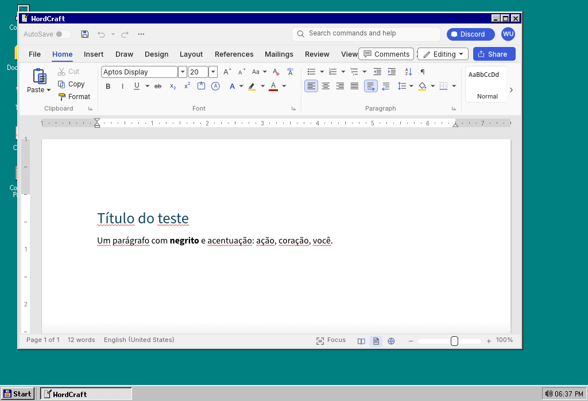 | 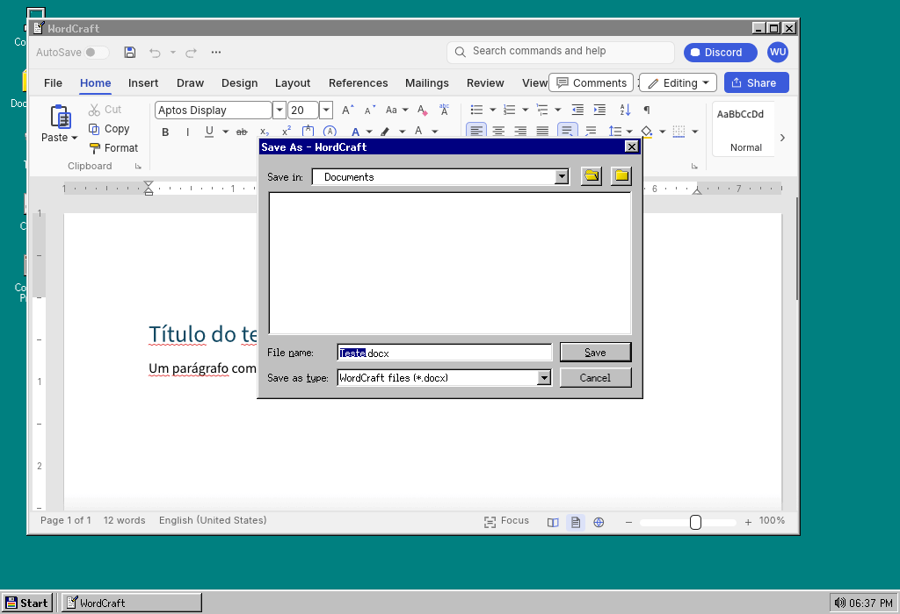 |
| 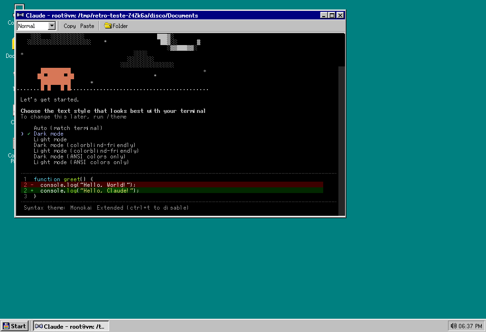 | 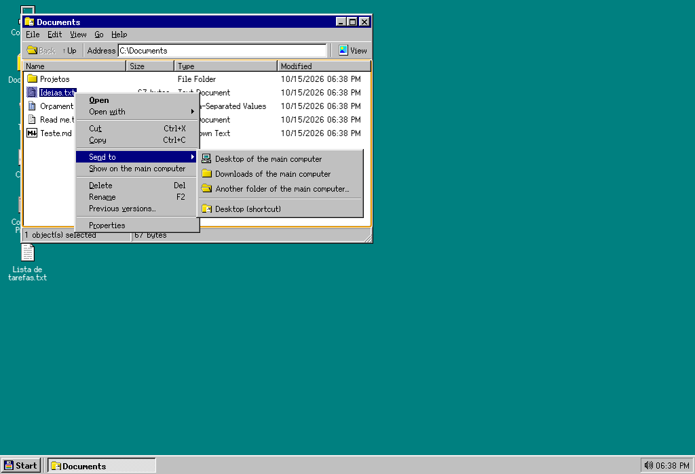 |
| 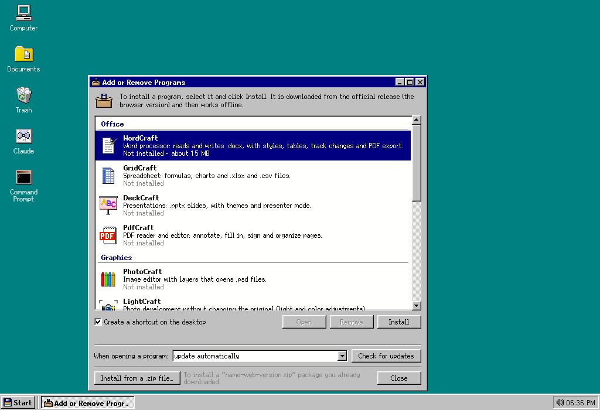 | 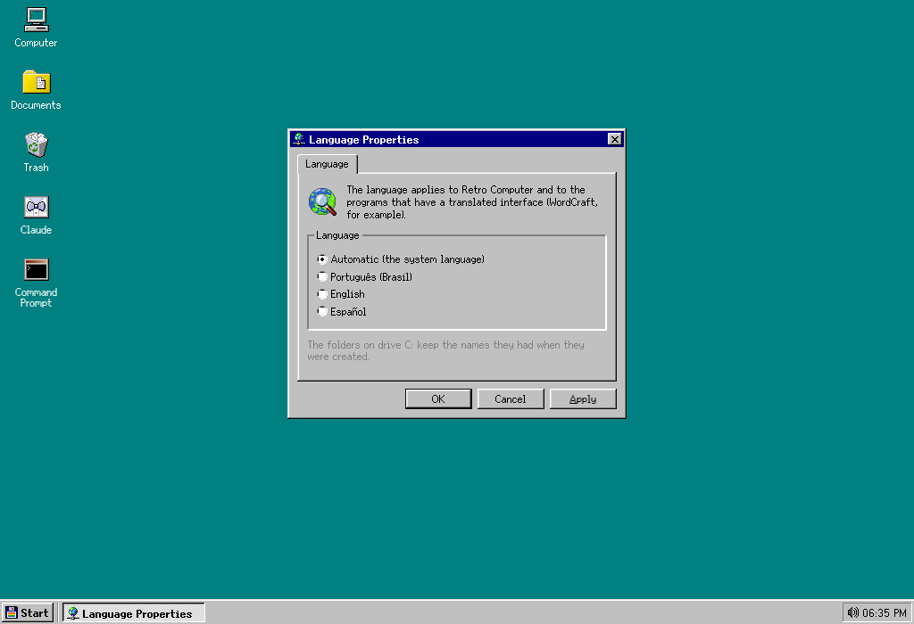 |
| 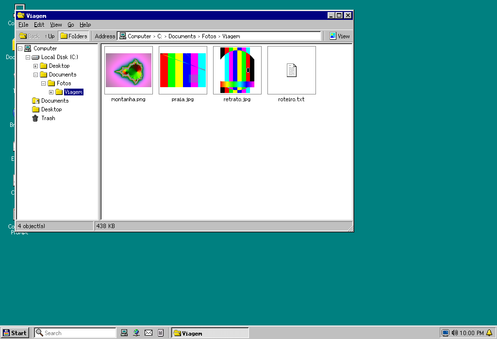 | 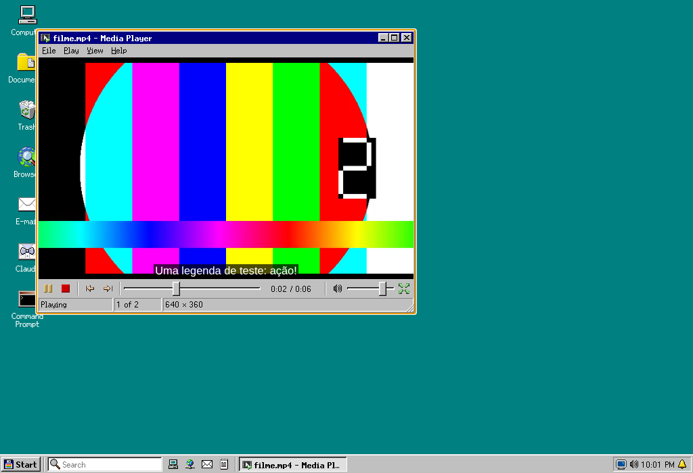 |
| 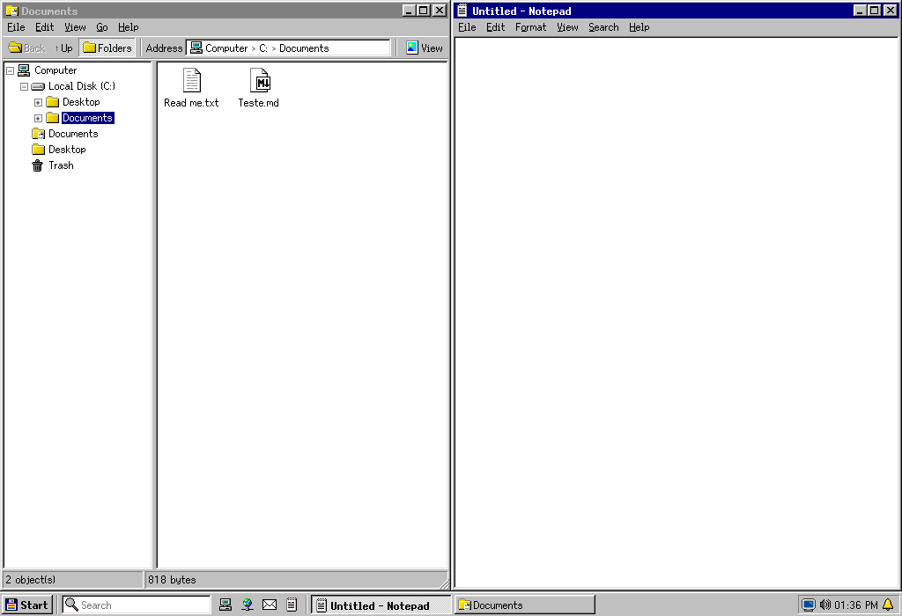 | 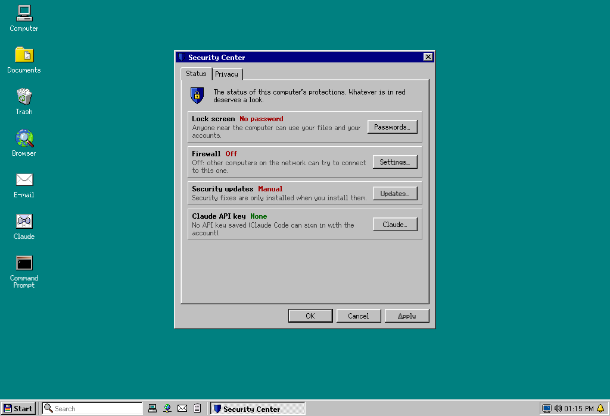 |
| 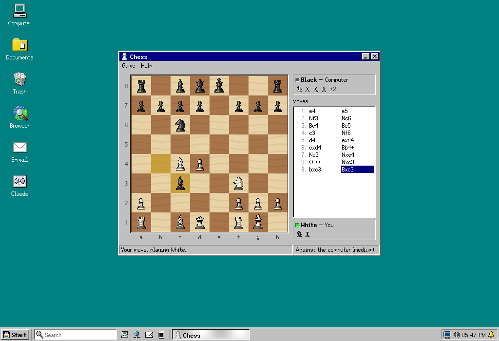 | 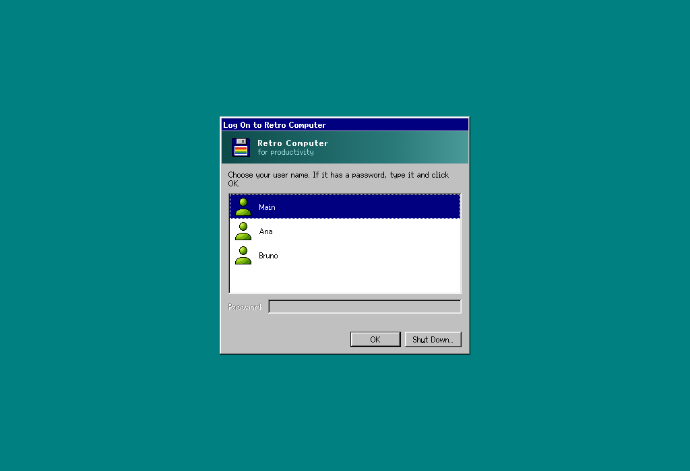 |

## Install

Download the installer for your system from the [latest release](https://github.com/EduChacon/Retro-Computer-for-Productivity/releases/latest):

| System | File |
|---|---|
| Windows | `Retro-Computer-…-win-x64.exe` (installer) or `…-win-x64.zip` |
| macOS 12 or newer | `…-mac-arm64.dmg` (Apple Silicon) or `…-mac-x64.dmg` (Intel) |
| Linux (PC) | `…-linux-amd64.deb` or `…-linux-x86_64.AppImage` |
| Linux (Raspberry Pi, 64-bit) | `…-linux-arm64.deb` or `…-linux-arm64.AppImage` |

The installers are not digitally signed yet, so the system asks for confirmation the first time:

- **macOS**: System Settings › Privacy & Security › Open Anyway (up to macOS 14, right-click the app › Open › Open also works).
- **Windows**: on the SmartScreen screen, "More info" › "Run anyway".

The [installation guide](docs/instalacao.md) (in Portuguese) has the steps for each computer: Windows, macOS, an old Mac such as a 2014 MacBook Air with Linux Mint, a virtual machine in UTM, an old laptop or mini PC, and the Raspberry Pi.

### As the Linux system (an old laptop, a Raspberry Pi or a mini PC)

Install the `.deb` package (`sudo apt install ./Retro-Computer-1.0.0-linux-amd64.deb`, or `arm64` on a Raspberry Pi) and choose the **Retro Computer** session on the login screen: the computer opens straight into Retro Computer, without the Linux desktop underneath. See [the usage guide (in Portuguese), section 7](docs/uso.md#7-num-mini-computador-raspberry-pi-e-como-o-sistema-do-linux). On a Raspberry Pi:

- **Raspberry Pi 4 or 5 (4 GB or more)**: everything works, including the Craft apps and Claude Code.
- **Raspberry Pi 3 (1 GB)**: the desktop, Notepad, Focus and the Command Prompt work; the Craft apps need WebGL2, which the Pi 3's graphics chip lacks (they run in software, very slowly), and Claude Code officially needs 4 GB of memory.

## Develop

```
npm install      # installs the dependencies (and builds the terminal for Electron)
npm start        # opens Retro Computer
npm test         # the tests
```

The code and the developer guide are written in Portuguese; see [AGENTS.md](AGENTS.md) (for people and AI agents). Translations live in [`src/sistema/idiomas/`](src/sistema/idiomas/), and `node ferramentas/textos.js` lists any missing ones.

## Credits

System icons and fonts from [SerenityOS](https://github.com/SerenityOS/serenity) (BSD-2-Clause), plus the project's own drawings; terminal by xterm.js and node-pty; DOS by [js-dos](https://js-dos.com/) (the DOSBox emulator, GPL-2.0, unmodified); the Mac Plus by [PCE.js](https://github.com/jsdf/pce) (GPL-2.0, unmodified); document previews by mammoth and pdf.js; `.zip` files by yauzl and yazl; self-updates by electron-updater; application built with Electron. The computer's programs come from Flathub, winget and Homebrew. The Craft apps are by the ArtCraft Team and are downloaded from their official releases. Details in [ATRIBUICOES.md](ATRIBUICOES.md).

The look pays tribute to the personal computers of the 1990s; no icon, font, sound or image from Microsoft or Apple is used.
