# Retro Computer

[English](README.md) · **Português** · [Español](README.es.md)

Um computador retrô para produtividade: a área de trabalho de um PC dos anos 90, com os programas de trabalho, os seus arquivos e o Claude Code, sem as distrações do computador de hoje. Funciona no Windows, no macOS e no Linux (inclusive no Raspberry Pi), e no Linux pode ser o sistema inteiro do computador, transformando um notebook antigo ou um mini PC num computador retrô dedicado. Código aberto (licença MIT).

- **Versão:** 2.4.0 · [Baixar](https://github.com/EduChacon/Retro-Computer-for-Productivity/releases/latest)
- **Google Calendar:** sincronização da Agenda nos dois sentidos, alterações sem internet e escolha explícita em conflitos; exige configuração OAuth do Google.
- **Assistente:** oito mascotes animados, chat integrado com Claude Code ou Codex, anexos e ferramentas do sistema retrô.
- **Idiomas:** português, inglês e espanhol (Painel de controle › Idioma)
- **Como usar:** [docs/uso.md](docs/uso.md) · **Arquitetura e decisões:** [docs/proposta.md](docs/proposta.md)

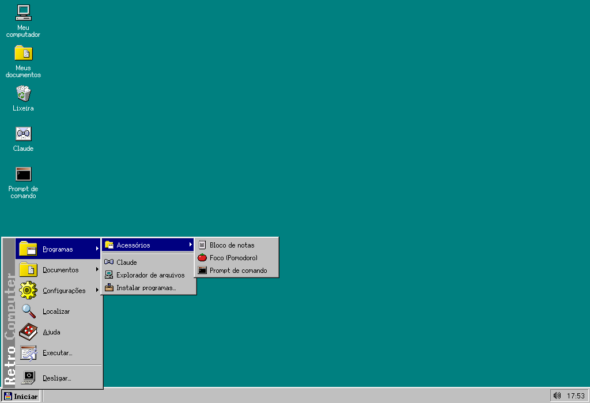

## O que ele faz

- **Área de trabalho dos anos 90**: botão Iniciar, barra de tarefas, janelas que se arrastam e redimensionam, ícones, menus, a Lixeira e a caixa de Desligar, com letras e ícones nítidos em qualquer monitor.
- **Ou um Mac dos anos 90**: o tema Mac clássico, inspirado no Mac OS 9 (Painel de controle › Aparência › Tema), põe a barra de menus no alto da tela, dá às janelas o título listrado e a caixa de recolher, traz a Faixa de controle com os programas fixados e tem ícones próprios, todos desenhados pelo projeto.
- **Janelas que se encaixam e os atalhos de sempre**: arraste a janela até a borda (metade da tela) ou até um canto (um quarto); Alt+Tab, Alt+F4 e a tecla do logotipo com uma letra (E, R, D, V, L…) ou com as setas; Ctrl + a roda do mouse para o zoom.
- **Barra de tarefas como a de hoje**: a caixa de busca e os programas fixados ao lado do Iniciar; a bandeja com o Wi-Fi, o volume, a bateria e o brilho, o Bluetooth, as notificações e o calendário; e a tela de bloqueio com senha.
- **O disco C: é uma pasta do seu computador** (`Documentos/Retro Computer`): o que você salva fica visível também fora do programa. Para trazer arquivos, arraste-os para uma janela; para levar, use "Enviar para". Meu computador › Computador principal mostra a área de trabalho, os documentos e os downloads do computador principal, e o Retro Computer pode entrar no "Enviar para" do Windows (no Mac, solte os arquivos no ícone dele no Dock): os arquivos vão e voltam, sempre como cópias. Você escolhe o programa padrão de cada tipo de arquivo. O Explorador tem abas, a barra de pastas, o endereço clicável, as miniaturas, o Acesso rápido, o painel de visualização dos documentos do Word, dos PDFs e das planilhas e a visualização rápida pela barra de espaço; a caixa de busca e o Localizar procuram também dentro dos documentos (textos, Word, planilhas, apresentações e PDFs); os pendrives e os cartões aparecem no Meu computador, e os `.zip` abrem como pastas.
- **Nada se perde**: excluir manda para a Lixeira, e cada gravação guarda a versão anterior do arquivo.
- **Programas de trabalho**: os [Craft](https://artcraft.run/) de código aberto (WordCraft para textos `.docx`, GridCraft para planilhas, DeckCraft para apresentações, PdfCraft, PhotoCraft e outros), instalados da versão oficial para navegador e rodando dentro das janelas. As caixas "Abrir" e "Salvar" deles usam o disco C:. Os programas instalados no computador também abrem pelo Iniciar, e o "Adicionar ou remover programas" instala ainda os programas do próprio computador, de fontes oficiais: o Flathub no Linux, o winget no Windows e o Homebrew no Mac.
- **Sempre atualizado**: ao abrir um programa, o Retro Computer procura a versão nova e a instala antes (ou pergunta, ou não procura, como você escolher). O próprio Retro Computer também se atualiza.
- **Claude Code** no Prompt de comando, nos seus arquivos, com a conta da assinatura ou com uma chave de API guardada no cofre de senhas do sistema. O botão direito num arquivo › Pedir ao Claude revisa, resume ou traduz; e, pedindo em palavras, ele ajusta o próprio Retro Computer (o fundo, a barra de tarefas, o menu Iniciar, os programas): o que ele apagar vai para a Lixeira, e a senha e a chave ficam fora do alcance dele.
- **Internet**: o Firefox como navegador padrão, com o visual do Retro Computer (ou o Navegador embutido, em que a câmera, o microfone e as notificações pedem a sua permissão), e o seu e-mail da web numa janela; qualquer site pode ser instalado como programa.
- **Ferramentas prontas**: Visualizador de imagens, Reprodutor de mídia, Captura de tela, Monitor do sistema, Calculadora (também na própria caixa de busca), Bloco de notas, o histórico da área de transferência (logotipo + V), Foco (Pomodoro, cronômetro e temporizador), a luz noturna, impressoras, Localizar, Executar, Painel de controle, proteção de tela, Ajuda, o Diário de trabalho, o Mapa de caracteres, a cópia de segurança do disco C:, o antivírus sob demanda, os Discos (formatar pendrives, gravar imagens `.iso` neles e o espaço em disco, com a limpeza), o Leitor de PDF (destacar trechos e pôr notas, com o original guardado como versão anterior), o Salvar como PDF no Bloco de notas, no Visualizador de imagens e no Navegador, as Ferramentas de PDF (combinar, separar, extrair páginas, girar e converter imagens), o Digitalizar (os scanners no Linux e no Windows) e o Copiar o texto (o OCR das fotos e dos PDFs digitalizados, sem internet), a Agenda (um `.ics` comum do disco C:, com lembretes, e os calendários da internet, como o Google Agenda e o Outlook, só para ler), a nuvem no Linux (o Google Drive, o OneDrive e o Dropbox como unidades no Meu computador), o corretor ortográfico (português, inglês e espanhol, sem internet), as notas autoadesivas na área de trabalho, o Receber do celular (fotos e arquivos pela rede local, com o código QR), o painel de emojis (logotipo + .), as áreas de trabalho virtuais com a Visão das tarefas (logotipo + Tab), os esquemas de cores (também escuros, que trocam sozinhos no pôr do sol), as Opções de acessibilidade e cinco jogos (Paciência, Campo Minado, Breakout, Damas e Xadrez, contra o computador ou contra alguém).
- **DOS, Mac e programas do Windows**: um emulador de DOS embutido (sem internet) para os programas e os jogos antigos do disco C:, um emulador do Mac Plus para os jogos clássicos do Macintosh (com a ROM e os discos do seu Mac: nada da Apple vem junto) e, no Linux, os programas do Windows pelo WINE.
- **Vários usuários**: cada pessoa com a área de trabalho, as configurações, a senha e o disco C: próprios, escolhida ao abrir o Retro Computer; os programas são de todos.
- **Segurança e privacidade num lugar só**: a Central de segurança mostra a senha da tela de bloqueio, o firewall (no Linux), as atualizações de segurança automáticas e como a chave do Claude está guardada; o Navegador só abre conexões seguras (HTTPS), a não ser que você escolha outra coisa, e pode apagar os dados dele ao fechar.
- **Linux como sistema**: a sessão "Retro Computer" da tela de entrada abre direto nele; Desligar desliga o computador de verdade, os programas do Linux aparecem na barra de tarefas, as atualizações de segurança são instaladas pelo Painel de controle, o som, a energia, a data e a hora, o mouse, a resolução e as várias telas se ajustam no Painel de controle, e as teclas do logotipo, de volume, de brilho e Print Screen funcionam.
- **No pendrive**: com uma pasta `Retro Computer (dados)` ao lado do programa, as configurações, os programas e o disco C: vão junto (o modo portátil).

| | |
|---|---|
| 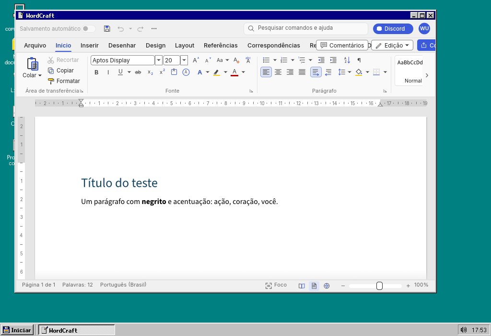 | 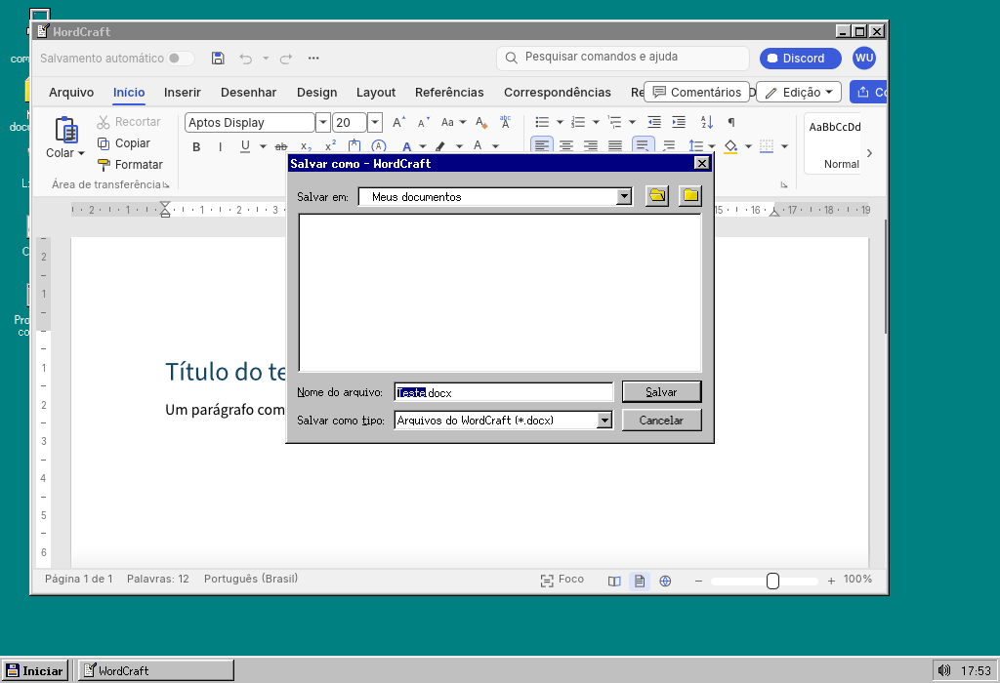 |
| 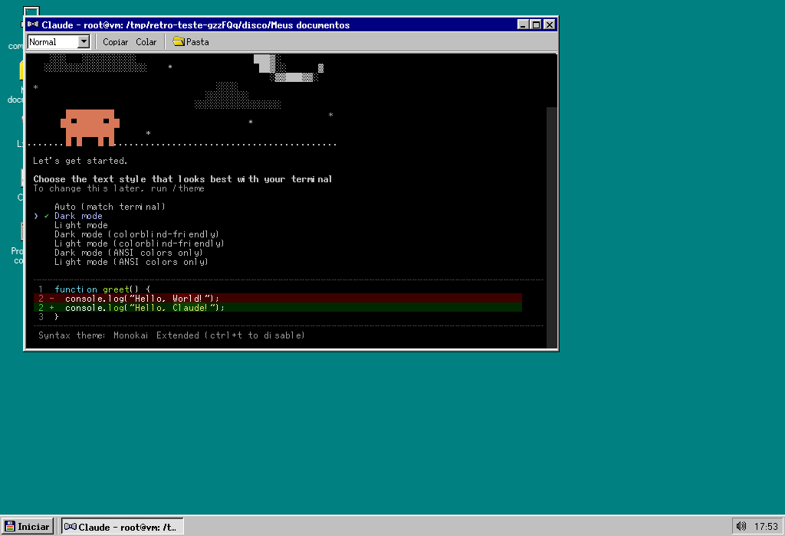 | 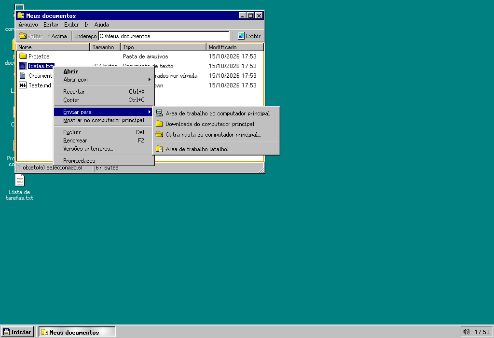 |
| 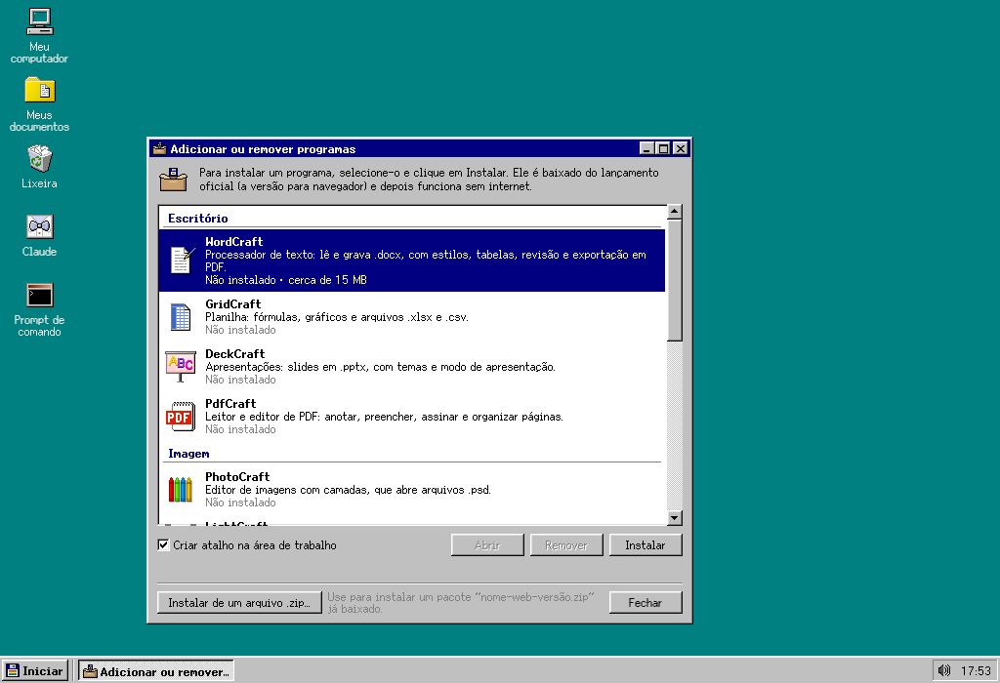 | 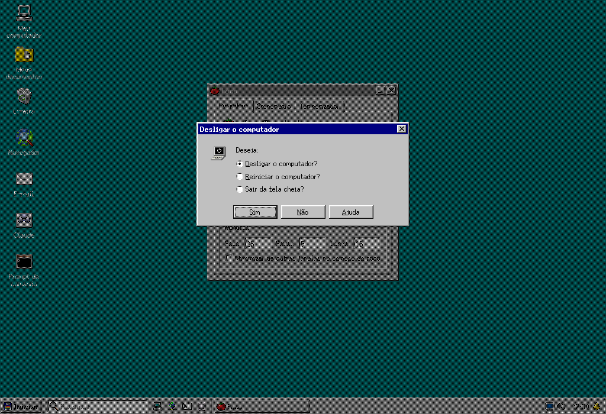 |
| 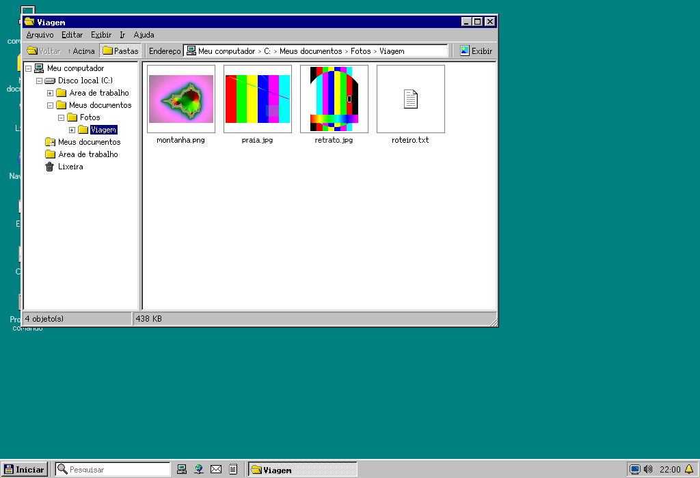 | 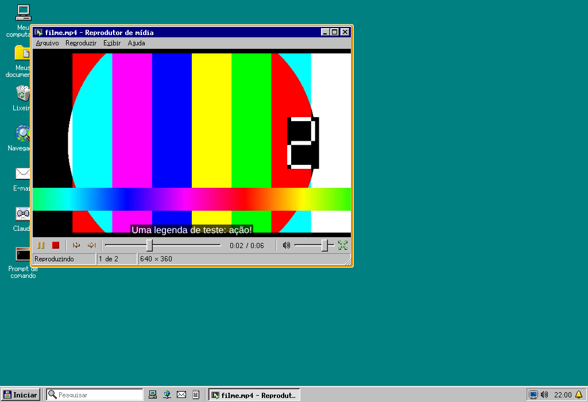 |
| 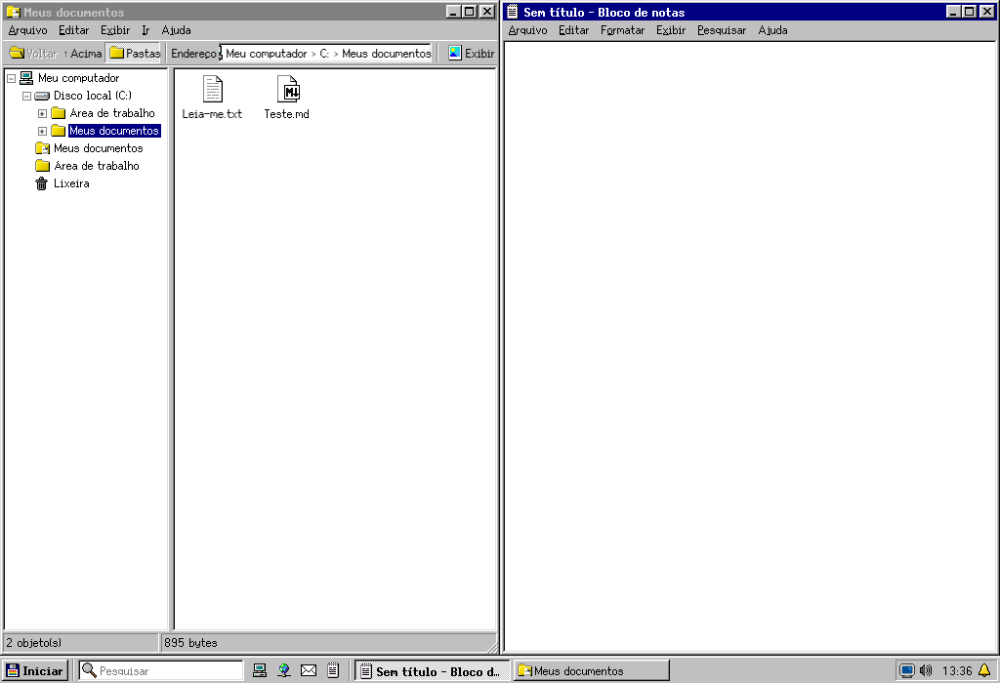 | 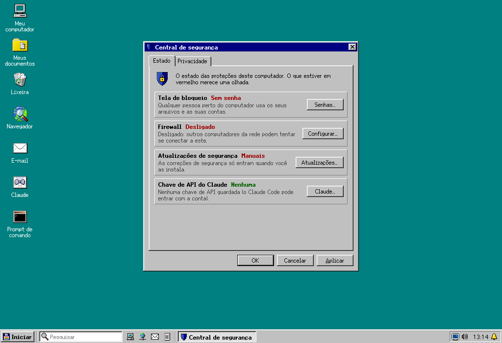 |
| 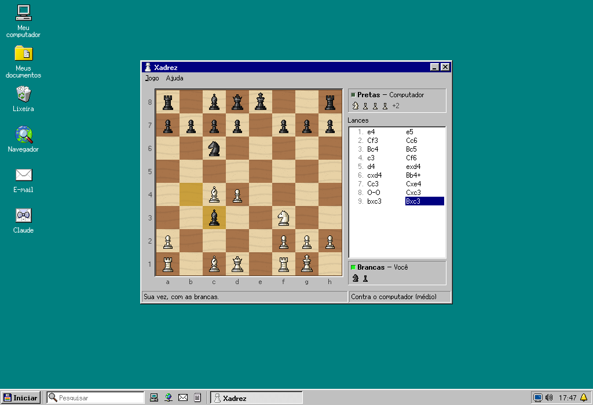 | 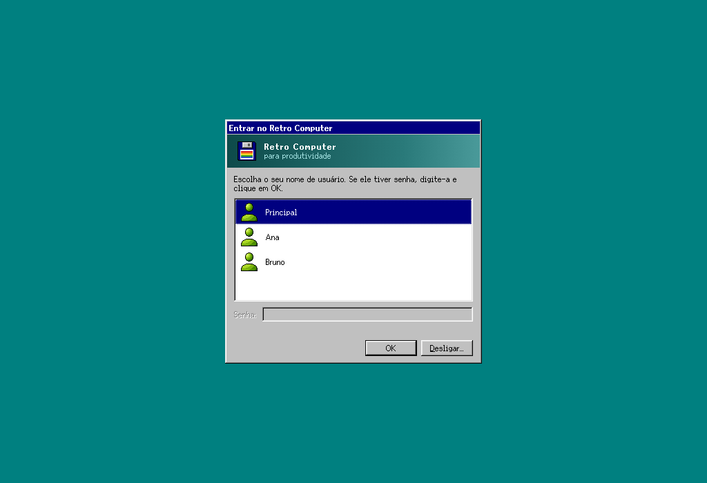 |

## Instalar

Baixe o instalador do seu sistema no [último lançamento](https://github.com/EduChacon/Retro-Computer-for-Productivity/releases/latest):

| Sistema | Arquivo |
|---|---|
| Windows | `Retro-Computer-…-win-x64.exe` (instalador) ou `…-win-x64.zip` |
| macOS 12 ou mais novo | `…-mac-arm64.dmg` (Apple Silicon) ou `…-mac-x64.dmg` (Intel) |
| Linux (PC) | `…-linux-amd64.deb` ou `…-linux-x86_64.AppImage` |
| Linux (Raspberry Pi, 64 bits) | `…-linux-arm64.deb` ou `…-linux-arm64.AppImage` |

Os instaladores ainda não têm assinatura digital: na primeira abertura, o sistema pede uma confirmação. O [guia de instalação](docs/instalacao.md) traz o passo a passo de cada computador: o Windows, o macOS, um Mac antigo (como o MacBook Air de 2014, com o Linux Mint), uma máquina virtual no UTM, um notebook antigo ou mini PC e o Raspberry Pi.

### Como o sistema do Linux (um notebook antigo, um Raspberry Pi ou um mini PC)

Instale o pacote `.deb` (`sudo apt install ./Retro-Computer-1.0.0-linux-amd64.deb`, ou o `arm64` no Raspberry Pi) e escolha a sessão **Retro Computer** na tela de entrada: o computador abre direto no Retro Computer, sem a área de trabalho do Linux por baixo. Veja [docs/uso.md, seção 7](docs/uso.md#7-num-mini-computador-raspberry-pi-e-como-o-sistema-do-linux). No Raspberry Pi 4 ou 5 (4 GB ou mais), tudo funciona; no Raspberry Pi 3 (1 GB), funcionam a área de trabalho, o Bloco de notas, o Foco e o Prompt, mas os Craft (que precisam de WebGL2) ficam muito lentos e o Claude Code pede 4 GB de memória.

## Desenvolver

```
npm install      # instala as dependências (e compila o terminal para o Electron)
npm start        # abre o Retro Computer
npm test         # os testes
```

O guia para quem programa (pessoas ou agentes de IA) está em [AGENTS.md](AGENTS.md).

## Créditos

Ícones e fontes de sistema do [SerenityOS](https://github.com/SerenityOS/serenity) (BSD-2-Clause), com desenhos próprios do projeto; terminal com xterm.js e node-pty; o DOS com o [js-dos](https://js-dos.com/) (o emulador DOSBox, GPL-2.0, sem modificação); o Mac Plus com o [PCE.js](https://github.com/jsdf/pce) (GPL-2.0, sem modificação); a visualização dos documentos com o mammoth e o pdf.js; os `.zip` com yauzl e yazl; a atualização do aplicativo com electron-updater; aplicativo em Electron. Os programas do computador vêm do Flathub, do winget e do Homebrew. Os Craft são do ArtCraft Team e são baixados dos lançamentos oficiais. Detalhes em [ATRIBUICOES.md](ATRIBUICOES.md).

O visual homenageia os computadores pessoais dos anos 90; nenhum ícone, fonte, som ou imagem da Microsoft ou da Apple é usado.
